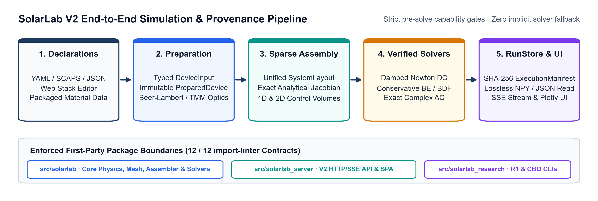
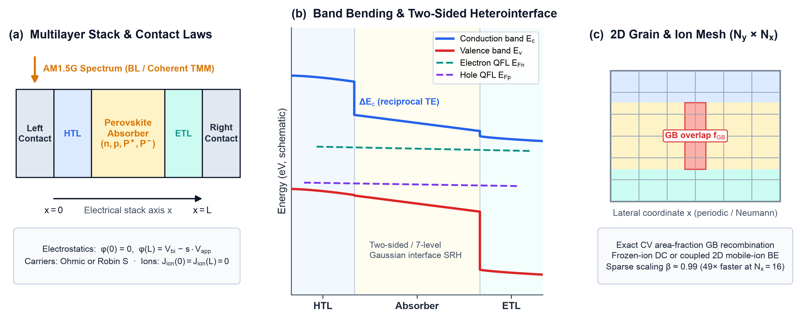
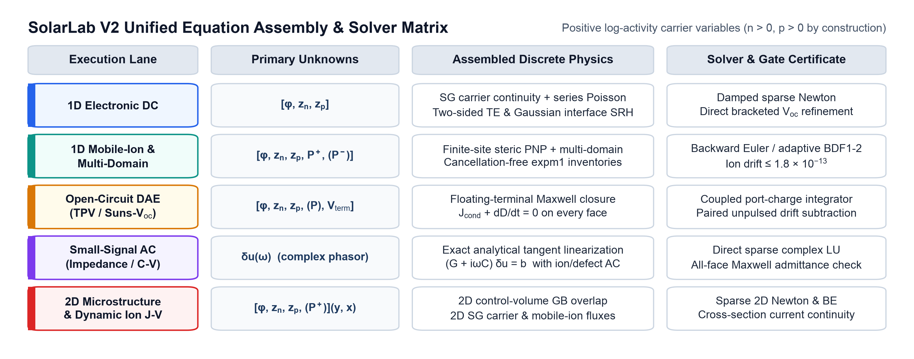
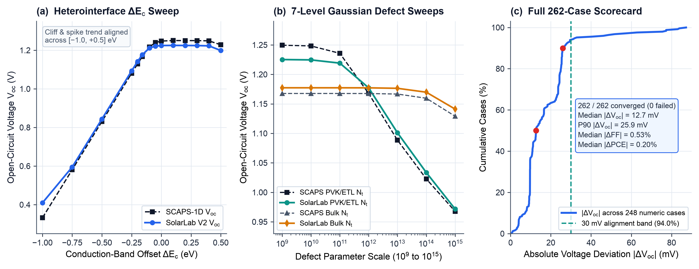
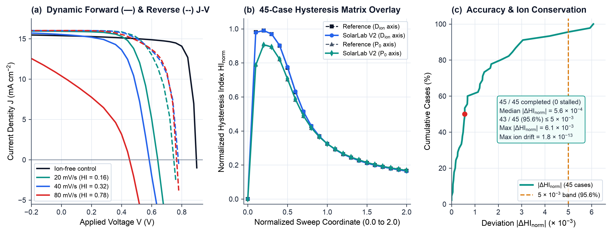

<div align="center">

# ☀️ SolarLab

**Thin-Film & Tandem Solar Cell Simulation Platform**

*1D/2D Drift-Diffusion · Series Poisson · Finite-Site Mobile Ions · Coherent Transfer-Matrix Optics*

Perovskite · CIGS · c-Si · Monolithic 2T Tandems

<br>

[](https://www.python.org)
[](https://fastapi.tiangolo.com)
[](https://vitejs.dev)

<br>

Xuan-Yan Chen · Longhan Zhang · Zecheng Gan<sup>&#42;</sup> · Chang Yan<sup>&#42;</sup> · Tongyi Zhang<sup>&#42;</sup>

*The Hong Kong University of Science and Technology (Guangzhou)*

</div>

<br>

## Table of Contents

| # | Section | Scope |
|--:|:--------|:------|
| 1 | [Overview & Highlights](#1-overview--highlights) | Platform positioning and core design pillars |
| 2 | [Architecture & Repository Layout](#2-architecture--repository-layout) | Three-package V2 layout and navigation map |
| 3 | [Quickstart](#3-quickstart) | Environment setup, CLI, V2 server, and web workstation |
| 4 | [Experiment & Capability Matrix](#4-experiment--capability-matrix) | 1D, 2D, tandem, screening, and UI capabilities |
| 5 | [Governing Physics & Numerical Method](#5-governing-physics--numerical-method) | PDEs, heterointerfaces, optics, and unified sparse assembly |
| 6 | [Validation Benchmarks & Scope](#6-validation-benchmarks--scope) | 262-case SCAPS & 45-case hysteresis alignment vs formal qualification |
| 7 | [Presets & Verification Suite](#7-presets--verification-suite) | Shipped device configurations and CI test gates |
| 8 | [References & Contact](#8-references--contact) | Literature and author correspondence |

---

## 1. Overview & Highlights

**SolarLab** is a research-grade device simulation platform for thin-film and monolithic tandem photovoltaics. It couples **Poisson electrostatics**, **drift-diffusion carrier continuity**, **steric mobile-ion migration**, **explicit bulk/interface defect thermodynamics**, and **wavelength-resolved transfer-matrix optics** under a unified sparse equation-assembly architecture, paired with a **FastAPI / SSE** execution service and an interactive **Vite / TypeScript / Plotly** browser workstation.

- **Unified Sparse Equation Assembly (`solarlab.equations.assembly`)** — Positive log-activity carrier variables $(z_n, z_p)$ guarantee $n > 0$ and $p > 0$ at every iterate without density clipping, while shared `SystemLayout` + `Term` contracts assemble exact sparse analytical Jacobians across 1D DC, transient, small-signal AC, and 2D microstructure solves.
- **Strict Conservation & Reciprocity** — Cancellation-free `expm1` control-volume inventories maintain ionic mass conservation below $1.8 \times 10^{-13}$ relative drift; heterojunctions enforce per-side DOS Bethe/Richardson thermionic reciprocity, two-sided / 7-level Gaussian interface SRH, and series-dielectric face capacitance.
- **End-to-End Cryptographic Provenance (`RunStore` & `ExecutionManifest`)** — Every configuration, optical table, protocol, and compiled solver state is content-hashed (`H_input`, `H_physics`, `H_execution`). Completed runs and failed prefixes are persisted losslessly for solver-free readback.
- **Enforced Package Isolation** — `solarlab` (core physics & solvers), `solarlab_server` (V2 HTTP/SSE job service & bundled SPA), and `solarlab_research` (`R1` codec & `CBO` scan CLIs) obey 12 machine-checked `import-linter` boundary contracts.

> [!NOTE]
> `devel` is the shared V2 engineering baseline (`solarlab==0.1.0`); `AIMC` is the separate research branch for microscopic aging models. For contributor rules and retired legacy provenance, see [DevelopmentGuide.md](docs/DevelopmentGuide.md) and [RetiredModelsV1.md](docs/RetiredModelsV1.md).

---

## 2. Architecture & Repository Layout

<p align="center">
  
</p>

```text
SolarLab/
├── src/
│   ├── solarlab/               Core kernel: config, materials, mesh, physics, equations, solvers, experiments, io
│   ├── solarlab_server/        V2 FastAPI/SSE job service, RunStore routes, ProcessSupervisor, and SPA serving
│   └── solarlab_research/      Research companion CLIs (solarlab-cbo-scan, solarlab-r1-short-window, r1-verify-sources)
├── web/                        Vite + TypeScript + Plotly + GoldenLayout V2 workstation frontend
├── examples/
│   ├── research_1d/            23 runnable 1D steady, AC, transient, mobile-ion, optical, and HTTP/process workflows
│   └── research_2d/            10 runnable 2D steady, J-V, grain-boundary, contact, field-mobility, and optical workflows
├── docs/
│   ├── DevelopmentGuide.md     Extension workflow, unified assembly rules, and branch governance
│   ├── RetiredModelsV1.md      Retired legacy entrypoints, falsified closures, and historical anchors
│   ├── contracts/              34 active physical model, defect, optical, and 2D protocol specifications
│   └── figures/                Pure-Arial 300 DPI architecture, physics, solver, and validation figures
├── reproducibility/            Frozen SCAPS, hysteresis, analytic, and performance contracts
├── scripts/                    Root CI runner (test_all.py), schema generator, figure builder, and benchmarks
└── tests/                      ci, unit, integration, refactor, runtime suites + 52 YAML device fixtures
```

**Directory Guides:**
- Developer workflow & model extension contract: [docs/DevelopmentGuide.md](docs/DevelopmentGuide.md)
- Physical & numerical model contracts (`34` specs): [docs/contracts/README.md](docs/contracts/README.md)
- Frozen benchmark & reference contracts: [reproducibility/README.md](reproducibility/README.md)
- Runnable 1D & 2D research workflows: [examples/research_1d/README.md](examples/research_1d/README.md) · [examples/research_2d/README.md](examples/research_2d/README.md)

---

## 3. Quickstart

### Prerequisites
- **Python 3.11+** with [`uv`](https://docs.astral.sh/uv/) (local lock targets Python 3.13; CI verifies Python 3.11 & 3.13)
- **Node.js 22.12+** with `npm`

### 1. Install & Verify Clean Package Isolation

```bash
git clone https://github.com/ShaneLogic/SolarLab.git
cd SolarLab

uv sync --frozen --all-extras
npm ci --prefix web
npm --prefix web run build

.venv/bin/solarlab check-install --require-no-legacy
```

### 2. Run From the CLI

```bash
# 1D ion-free steady-state J-V sweep on the packaged classical_pin preset
.venv/bin/solarlab steady-jv --output outputs/steady_jv.json

# Research companion CLI entrypoints
.venv/bin/solarlab-cbo-scan --help
.venv/bin/solarlab-r1-short-window --help
```

### 3. Launch the V2 Web Workstation

Start the V2 `solarlab-server` backend (serves `/configs`, `/materials`, `/experiments`, `/jobs`, `/runs/.../events`, `/results/...`, and compiled `web/dist` on port `8000`):

```bash
.venv/bin/solarlab-server --store-dir ./var/solarlab/store --host 127.0.0.1 --port 8000
```

For hot-reload frontend development, start Vite in a second terminal and open **<http://127.0.0.1:5173>**:

```bash
npm --prefix web run dev
```

Or launch the containerized stack directly via `docker compose up --build`.

---

## 4. Experiment & Capability Matrix

All characterisation workflows compile from the same validated device declaration (`YAML`, `SCAPS YAML`, or `JSON`):

| Domain | Experiment / Capability | Primary Module | Output & Physical Checks |
|:-------|:------------------------|:---------------|:-------------------------|
| **1D Steady & Sweeps** | Illuminated $J\text{–}V$ & direct $V_{\mathrm{oc}}$ | `solarlab.experiments.jv` | $V_{\mathrm{oc}}, J_{\mathrm{sc}}, \mathrm{FF}, \mathrm{PCE}$, interior/contact currents, exact $V_{\mathrm{oc}}$ sign bracket |
| | Dark diode $J\text{–}V$ | `solarlab.experiments.dark_jv` | Auto-windowed $\ln J\text{–}V$ ideality factor $n_{\mathrm{id}}$ and $J_0$ |
| | Parameter sweeps | `solarlab.sweeps` | Cold-compiled multi-parameter studies with persisted `RunStore` attempts |
| **1D Dynamic & Open-Circuit** | Waveform / Hysteresis $J\text{–}V$ | `solarlab.experiments.waveform_jv` | Continuous preconditioning + forward/reverse mobile-ion loops, $\mathrm{HI}_{\mathrm{norm}}$, current decomposition |
| | Suns-$V_{\mathrm{oc}}$ & $V_{\mathrm{oc}}(T)$ | `solarlab.experiments.suns_voc`, `voc_t` | Series-resistance-free pseudo-$J\text{–}V$, pseudo-$\mathrm{FF}$, activation-energy intercept |
| | Transient Photovoltage (TPV) | `solarlab.experiments.tpv` | Floating-port Maxwell $J_{\mathrm{cond}} + \partial_t D = 0$ pulse + paired unpulsed drift subtraction |
| | Frozen-ion degradation | `solarlab.experiments.degradation` | Long-time ionic evolution with zero-diffusivity electronic snapshot $J\text{–}V$ probes |
| **1D Small-Signal AC** | Impedance spectroscopy $Z(\omega)$ | `solarlab.experiments.impedance`, `ionic_impedance` | Exact sparse complex solve $(G + i\omega C)\delta u = b$, Nyquist/Bode, coupled ion & dynamic-defect tangents |
| | Mott–Schottky ($C\text{–}V$ / $C\text{–}f$) | `solarlab.experiments.mott_schottky` | Depletion $1/C^2$ extraction of $V_{\mathrm{bi}}$ and $N_{\mathrm{eff}}$ |
| **Spectral & Multi-Junction** | Monochromatic EQE & EL | `solarlab.experiments.eqe`, `el_spectrum` | Coherent TMM or spectral Beer–Lambert $\mathrm{EQE}(\lambda)$, AM1.5G $J_{\mathrm{sc}}$, reciprocity EL |
| | 2T Monolithic Tandem | `solarlab.experiments.tandem_jv` | Joint 4-region coherent TMM photon budget + series current-matched sub-cell $J\text{–}V$ |
| **2D & Screening** | 2D $J\text{–}V$ & $V_{\mathrm{oc}}(L_g)$ grain sweep | `solarlab.experiments.two_dimensional` | Exact control-volume grain-boundary SRH overlap, frozen-ion DC or coupled 2D mobile-ion BE |
| | SolarScale material screening | `solarlab.experiments.solarscale`, `evaluation_report` | Candidate ingestion, band-alignment gates, sweep manifests, and publication-gated report packs |

**Web Workstation Layout (`web/`):**
- **Left Rail (`Devices / Results`)** — Switch between active device configurations and stored `RunStore` attempts for multi-curve overlay.
- **Center Pane (`Stack & Parameter Editor`)** — Interactive layer builder, grouped parameter editors (*Geometry, Transport, Recombination & Defects, Ions & Optics, Contacts*), live schema preview, and lossless YAML import/export.
- **Right Pane (`Experiment Runner & Dockable Plots`)** — Protocol controls, live SSE progress/cancellation, and GoldenLayout Plotly views ($J\text{–}V$, Nyquist/Bode, spatial $\varphi, E, n, p, P$ profiles, and 2D heatmaps).

---

## 5. Governing Physics & Numerical Method

<p align="center">
  
</p>

### 1. Electrostatics & Contact Potentials
On 1D ($x \in [0, L]$) or 2D ($(y, x)$) control volumes, electrostatic potential $\varphi$ satisfies Gauss's law with exact sub-face series dielectric capacitance $C_f = \varepsilon_0 / (d_{f,L}/\varepsilon_L + d_{f,R}/\varepsilon_R)$:

$$
-\nabla \cdot \bigl(\varepsilon_0 \varepsilon_r \nabla \varphi\bigr)
= q\Bigl(p - n + N_D - N_A + \sum_\alpha z_\alpha (P_\alpha - P_{\alpha,0}) + \rho_{\mathrm{trap}}\Bigr).
$$

Outer electrostatic boundaries enforce $\varphi(0) = 0$ and $\varphi(L) = V_{\mathrm{bi}}^{\mathrm{bc}} - s V_{\mathrm{app}}$ with $s = \mathrm{sgn}\bigl(V_{\mathrm{bi}}^{\mathrm{bc}}\bigr)$, where $V_{\mathrm{bi}}^{\mathrm{bc}}$ is derived self-consistently from semiconductor or explicit metal work functions (subject to a strict $5\text{ meV}$ contact thermodynamic equilibrium check). Carrier contacts support equilibrium Dirichlet reservoirs or finite-rate selective Robin velocities $J_{c,s} = \sigma_{c,s} q S_{c,s}(u_c - u_{c,\mathrm{eq}})$.

### 2. Carrier Continuity, Heterointerfaces & Recombination
Carriers are parameterized via positive log-activity coordinates $(z_n, z_p)$ so $n > 0$ and $p > 0$ hold identically:

$$
\frac{\partial n}{\partial t} = \frac{1}{q}\nabla \cdot \mathbf{J}_n + G - R, \qquad
\frac{\partial p}{\partial t} = -\frac{1}{q}\nabla \cdot \mathbf{J}_p + G - R,
$$

discretized on interior faces with cancellation-safe Scharfetter–Gummel fluxes $J_{n,i+1/2} = (q D_n / \Delta x_i)\bigl[n_{i+1} B(\Delta\psi_{n,i}/V_t) - n_i B(-\Delta\psi_{n,i}/V_t)\bigr]$ where $B(x) = x/(e^x - 1)$ and $V_t = k_B T / q$ (with optional smooth Caughey–Thomas field-dependent velocity saturation). Bulk recombination sums SRH (or explicit monovalent/multivalent/Gaussian bulk defect occupancies), radiative (with optional Yablonovitch photon recycling), and Auger rates:

$$
R = \frac{np - n_i^2}{\tau_p(n + n_1) + \tau_n(p + p_1)} + k_{\mathrm{rad}}(np - n_i^2) + (C_n n + C_p p)(np - n_i^2).
$$

Across abrupt heterojunctions ($\Delta E_c, \Delta E_v \neq 0$), two-sided trace models enforce per-side DOS activities $(n_L/N_{C,L}, n_R/N_{C,R})$, reciprocal Richardson constants $\tilde{A}^* = \min(A^*_L, A^*_R)$, and two-sided single-level or 7-level Gaussian quadrature interface SRH without spurious thermal-equilibrium currents.

### 3. Finite-Site Mobile-Ion Migration
Confined single-domain or multi-domain mobile ions obey blocking boundary conditions ($\mathbf{F}_\alpha \cdot \mathbf{n} = 0$) and steric Poisson–Nernst–Planck fluxes (supporting single positive ions, independent dual ions, or shared-vacancy $\theta = (P_+ + P_-)/P_{\mathrm{lim}}$ populations):

$$
F_P = -D_{\mathrm{ion}}\left[\frac{1}{1 - \theta}\frac{\partial P}{\partial x} + \frac{P}{V_t}\frac{\partial \varphi}{\partial x}\right]
\quad \text{(or full-flux steric exclusion } (1-\theta)\text{ on drift + diffusion)}.
$$

### 4. Optical Generation (Spectral Beer–Lambert & Coherent TMM)
Optical generation integrates absorbed photon flux exactly over each electrical control volume so discrete carrier generation conserves the optical photon budget ($R + T + A_{\mathrm{elec}} + A_{\mathrm{parasitic}} = 1$) to machine precision:
- **Spectral Beer–Lambert (`beer_lambert_spectral`)** — Single-pass wavelength quadrature using cancellation-free cell absorptance $A_{\mathrm{cell}}(\lambda) = e^{-\tau_j(\lambda)}\bigl(-\mathrm{expm1}(-\Delta\tau_j(\lambda))\bigr)$.
- **Coherent Transfer-Matrix Optics (`tmm`)** — Multilayer complex $(n(\lambda), k(\lambda))$ standing-wave Poynting-vector absorption across single-junction and 2T monolithic tandem stacks, excluding front-glass and electrode parasitic absorption from carrier generation.

### 5. Unified Solver Matrix

<p align="center">
  
</p>

---

## 6. Validation Benchmarks & Scope

SolarLab separates **engineering verification**, **external solver alignment**, and **formal continuum scientific certification** (`scientific_qualification = False` until all external reference and continuum-refinement gates are independently closed; see [reproducibility/README.md](reproducibility/README.md)).

### 1. SCAPS-1D 262-Case Steady-State Alignment (`ScapsComparisonContractV1`)

<p align="center">
  
</p>

Evaluated from an isolated `solarlab==0.1.0` wheel across all **262** single- and two-parameter sweeps (`scaps_cbo`, `scaps_nt_cbo`, `scaps_nt_et`, bulk/interface $N_t$ & $E_t$, donor doping) using 7-level Gaussian interface quadrature, flat-band work-function $V_{\mathrm{bi}}$, and two-stage $5\text{ mV}$ $V_{\mathrm{mpp}}/V_{\mathrm{oc}}$ certification:
- **Convergence:** `262 / 262` cases converged (`0` solver failures).
- **Accuracy across 248 numeric reference points:** `233 / 248` (**`94.0%`**) satisfy $|\Delta V_{\mathrm{oc}}| \le 30\text{ mV}$; median $|\Delta V_{\mathrm{oc}}| = 12.7\text{ mV}$ (`P90 = 25.9 mV`), median $|\Delta\mathrm{FF}| = 0.53\%$, median $|\Delta\mathrm{PCE}| = 0.20\%$.
- **Residual diagnosis:** Independent zero-Auger radiative-limit ablation (`C_{n,p} = 0`) confirmed that the remaining $\sim 25\text{ mV}$ open-circuit plateau offset originates from an undocumented radiative-limit setting in the external partner's proprietary SCAPS project file + bundled `.spe` spectrum table (reducing `scaps_nt_cbo` median $|\Delta V_{\mathrm{oc}}|$ to `4.40 mV` and overall $|\Delta V_{\mathrm{oc}}| \le 20\text{ mV}$ coverage to `88.7%`).

### 2. 45-Case Dynamic Mobile-Ion Hysteresis Benchmark (`HysteresisReferenceContractV2`)

<p align="center">
  
</p>

Evaluated across the **45-case** 7-stage preconditioning + forward/reverse scan matrix spanning 6 decades of ion diffusivity, mobile-ion density, and scan rate:
- **Completion & Conservation:** `45 / 45` cases completed (`0` stalls), with maximum relative ionic inventory drift $\le 1.80 \times 10^{-13}$.
- **Hysteresis Index Parity:** Median $|\Delta\mathrm{HI}_{\mathrm{norm}}| = 5.64 \times 10^{-4}$, with `43 / 45` (**`95.6%`**) within $5 \times 10^{-3}$.
- **Four-Axis Decoupled Refinement Closure:** Phase 0 operator/conservation gates, time-step axis ($\le 6.3 \times 10^{-8}\text{ W m}^{-2}$), solver-tolerance axis ($\le 4.6 \times 10^{-8}\text{ W m}^{-2}$), and weak-peak $\mathrm{HI}_{\mathrm{normalized}}$ (`2.73e-4 <= 3.33e-4` at 241 nodes) are verified; unnormalized ratio $\mathrm{HI}_P$ at sub-nanometre Debye screening ($L_D \approx 0.54\text{ nm}$ on fixed `tanh` grids) and decoupled 100 s `R1-L2/L3` (`RS-G7`) remain explicitly open research gates.

---

## 7. Presets & Verification Suite

### Packaged Device Presets (`src/solarlab/materials/data/presets/`)

| Preset ID | Stack Topology | Mobile Ions | Optics | Primary Role |
|:----------|:---------------|:-----------:|:------:|:-------------|
| `classical_pin` | HTL / Absorber / ETL | No | Beer–Lambert | Default CLI & 1D/2D steady-state baseline |
| `scaps_mirror_v2` | Glass / Spiro-OMeTAD / $\mathrm{MAPbI_3}$ / $\mathrm{TiO_2}$ | No | TMM / Spectral BL | SCAPS-1D heterojunction & defect benchmark stack |
| `calado2016_ion_sweep` | HTL / Perovskite / ETL | Yes | Uniform / BL | Workstation dynamic ion-hysteresis waveform preset |
| `calado2016_fig1f` | Calado 2016 SI Table 1 stack | Yes | Beer–Lambert | Literature scan-rate hysteresis comparison preset |

An additional **52** YAML device and 2D microstructure test fixtures reside under `tests/fixtures/configs/` (isolated from API serving).

### Running the Full Verification Suite

```bash
# Run all 8 isolated root CI pytest selections (static, core, packages, backend, frontend)
.venv/bin/python scripts/test_all.py

# Static lint, strict typing, package boundary contracts, and schema sync
.venv/bin/ruff check --no-cache src scripts/test_all.py scripts/generate_configuration_schema.py scripts/ci tests/ci
.venv/bin/mypy --cache-dir /dev/null src/solarlab src/solarlab_server
.venv/bin/lint-imports --no-cache
.venv/bin/python scripts/generate_configuration_schema.py --check

# Frontend unit/integration suite (Vitest) and production bundle build
SOLARLAB_PYTHON="$PWD/.venv/bin/python" npm --prefix web run test:run
npm --prefix web run build
```

---

## 8. References & Contact

1. **Scharfetter, D. L. & Gummel, H. K.** (1969) — *Large-signal analysis of a silicon Read diode oscillator*. IEEE Trans. Electron Devices, 16(1), 64–77.
2. **Burkhard, G. F., Hoke, E. T. & McGehee, M. D.** (2010) — *Accounting for interference, scattering, and electrode absorption to make accurate internal quantum efficiency measurements in organic and other thin solar cells*. Adv. Mater., 22(30), 3293–3297.
3. **Calado, P. et al.** (2016) — *Evidence for ion migration in hybrid perovskite solar cells with minimal hysteresis*. Nat. Commun., 7, 13831.
4. **Courtier, N. E. et al.** (2019) — *IonMonger: a free and fast planar perovskite solar cell simulator with coupled ion vacancy and charge carrier dynamics*. J. Comput. Electron., 18, 1435–1449.
5. **Burgelman, M., Nollet, P. & Degrave, S.** (2000) — *Modelling polycrystalline semiconductor solar cells* (SCAPS-1D). Thin Solid Films, 361–362, 527–532.

<div align="center">

**Authors & Correspondence**

Xuan-Yan Chen · [xchen565@connect.hkust-gz.edu.cn](mailto:xchen565@connect.hkust-gz.edu.cn)<br>
Longhan Zhang · [lzhang619@connect.hkust-gz.edu.cn](mailto:lzhang619@connect.hkust-gz.edu.cn)<br>
Zecheng Gan<sup>&#42;</sup> · [zechenggan@hkust-gz.edu.cn](mailto:zechenggan@hkust-gz.edu.cn)<br>
Chang Yan<sup>&#42;</sup> · [changyan@hkust-gz.edu.cn](mailto:changyan@hkust-gz.edu.cn)<br>
Tongyi Zhang<sup>&#42;</sup> · [mezhangt@hkust-gz.edu.cn](mailto:mezhangt@hkust-gz.edu.cn)

<sup>&#42;</sup> Corresponding authors · *The Hong Kong University of Science and Technology (Guangzhou)*

</div>
